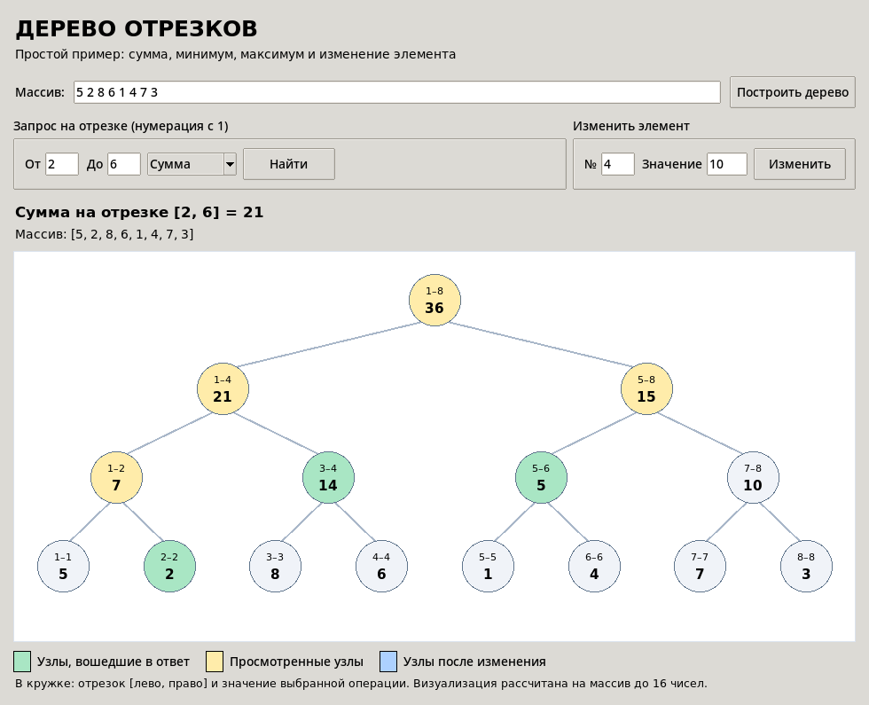

# Курсовая работа: дерево отрезков

**Выполнили:** Язылов А. Б., Фоломешкин Д. А., группа 5423, РГРТУ.

## Что делает программа

Дерево отрезков хранит массив чисел. Можно найти **сумму, минимум или максимум** на выбранном отрезке, а также **изменить один элемент**.



На рисунке для массива `[5, 2, 8, 6, 1, 4, 7, 3]` выбран отрезок с 2-го по 6-й элемент. Программа выдаёт **21**. Зелёные узлы входят в вычисление ответа, жёлтые просмотрены во время поиска.

## Файлы

- [`segment_tree.py`](segment_tree.py) - алгоритм дерева отрезков.
- [`app.py`](app.py) - простой графический интерфейс на Tkinter.
- [`test_segment_tree.py`](test_segment_tree.py) - 7 автоматических тестов.
- [`Курсовая.Docx`](Курсовая.Docx) - пояснительная часть курсовой.
- [`preview.png`](preview.png) - пример запроса с подсветкой узлов.
- [`after_update.png`](after_update.png) - пример изменения элемента.

## Как запустить

Нужен **Python 3** с Tkinter. Сторонние библиотеки не требуются.

```bash
python app.py
```

В поле **Массив** напишите числа через пробел и нажмите **Построить дерево**. Чтобы сделать запрос, выберите границы с **1**, нужную операцию и нажмите **Найти**. Чтобы обновить значение, введите номер элемента, новое число и нажмите **Изменить**.

Тесты:

```bash
python -m unittest -v test_segment_tree.py
```

## Сложность

- Построение: `O(n)`.
- Запрос суммы, минимума или максимума: `O(log n)`.
- Изменение одного элемента: `O(log n)`.
- Память: `O(n)`.

Для удобства рисунок дерева показывается при размере массива **до 16 элементов**. Вычисления работают и с большими массивами.
